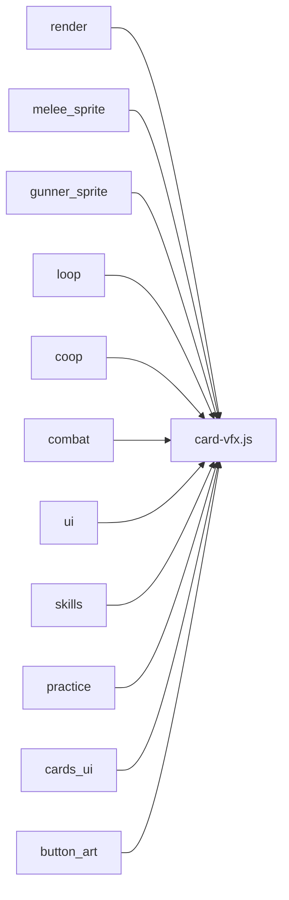
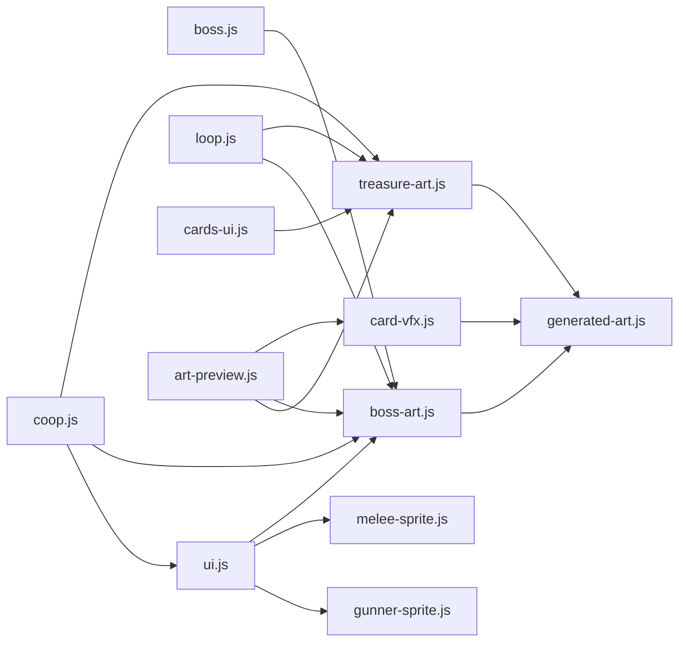
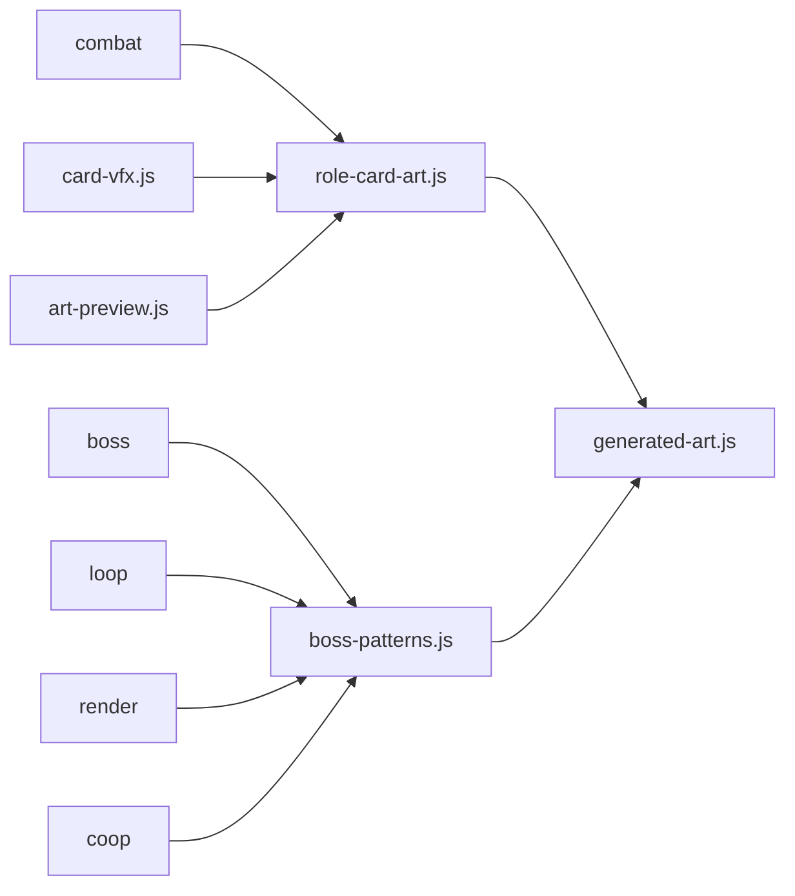

# Cute RPG Action Shooter — Architecture

## Module Overview

| Module | Purpose |
|--------|---------|
| src/card-vfx.js | Formal pixel card art, cached weapon materials, player attachment layers, projectiles, impacts and world effects. Shared by host/client and practice. |
| `src/main.js` | Entry point and glue code (~350 lines). Owns top-level state (g, _mode, _charType, _net, inv, etc.), wires all modules together via initXxx(deps), implements startGame(), overGoHome(), showCharSelect(), pickChar(), and the data-action event delegation listener. |
| `src/state.js` | Legacy shared state object S — originally intended as a central store; most modules now use their own module-level vars via dependency injection. Still holds dragon-pet sprite references. |
| `src/config.js` | Pure constants: map dimensions, player/enemy radii, cooldown timings, CHAR definitions (gunner/swordsman/tank), MODE definitions (classic/elite/coop/practice), rarity weights/colors, and the pickRole() function. |
| `src/cards.js` | Defines the C array of 52 card objects (each with id, name, emoji, rarity, description, and ap[] level-up functions). Also exports rndBuff() for random stat bonuses. |
| `src/utils.js` | Four pure utility functions: di (distance), cl (clamp), rn (random in range), $ (getElementById). |
| `src/audio.js` | Web Audio API synthesizer for all BGM and SFX. Manages a single AudioContext, plays looping BGM via OscillatorNode chains, and synthesizes game sounds (shoot, hit) procedurally. |
| `src/render.js` | All canvas drawing primitives: drawPlayer(), drawEnemy(), burst() particles, addLtn() lightning, drawPoly(), drawStar(), bCol() element color resolver, WP weapon configs, getWpn(). Owns the par[] particle pool and the fxQ render quality flag. |
| `src/hud.js` | HUD overlay (health bars, XP bar, wave/kill counters, ult charge ring), floating damage numbers (showPlayerDmg), hint queue (showHint), and minimap (drawMinimap). |
| `src/input.js` | Joystick touch tracking, keyboard input (ks object), mouse input, and the skill/ult button. Exports joy/aim state objects, setupInputListeners(), and request flags for coop (getClientUltReq, getClientDodgeReq). |
| `src/enemies.js` | Enemy spawning (spawn()), wave parameters (spawnTargetForWave, spikeConfigForWave), enemy growth curves (enemyGrowth, tierHpFor), crate generation (genCrates, spawnBonusCrates), spike wave and hunt pressure triggers. |
| `src/combat.js` | Bullet firing (fire()), sword swing (swordSwing()), shield bash (shieldBash()), auto-attack dispatch (tapAtk()), nearest-target query (nearestTargets()), kill award (awardEnemyKill()), and death settlement (settleEnemyDeaths()). |
| `src/skills.js` | Character special skills (useCharSkill, skillSnipe, skillGhostSlash, skillTaunt), dash (_startDash), and ultimate (doUlt). Manages skill/ult cooldown state and dash ghost trail. |
| `src/cards-ui.js` | Card pick UI (showPick()), angel card (showAngelCard()), big chest (triggerBigChest()), card inventory helpers (addCard, getCardLv, pks). |
| `src/boss.js` | Stage boss system for Lv20 (poo boss) and Lv30 (devil boss): triggerStageBoss(), updateStageBoss(), drawStageBoss(), checkStageBossDeath(), boss BGM management, boss SFX. |
| `src/coop.js` | PeerJS multiplayer: room creation/joining UI (coopShowCreate, coopJoinRoom, coopStart), host/client sync (serializeCoopState, applyCoopState), client render loop (clientRenderLoop), P2 card pick overlay, coop practice helpers. |
| `src/practice.js` | Practice mode: openPractice(), enemy spawning panel (pracSpawn, pracClear), card selection panel (pracCycleCard, pracRebuildCards), stats panel (pracRefreshStats), HP toggle, coop AI toggle, char switching. bindPracticeToWindow() exposes functions for dynamic innerHTML handlers. |
| `src/ui.js` | Game screens: show(), resize(), settings overlay (openSettings/closeSettings/settingsGoHome), stats panel (toggleStatsPanel), victory screen (showVictoryScreen/triggerVictory), game-over screen (showOver), end cutscene (playEndCutscene), phoenix revive animation. |
| `src/loop.js` | Main game loop (loop() called via requestAnimationFrame). Contains the full ~2400-line update/render tick: enemy AI, bullet physics, collision detection, wave progression, camera (cam()), nearestPlayer(), bothPlayers(), and the serializeCoopState wrapper. |

---

## Module Dependency Graph

```
utils.js        (no imports from project)
config.js       (no imports from project)
cards.js        (no imports from project)
state.js        (no imports from project)

audio.js        → (no project deps beyond browser APIs)

render.js       → utils, config

hud.js          → utils, render

input.js        → (no project deps beyond browser APIs)

enemies.js      → config, utils, render

combat.js       → config, utils, render, audio, enemies, cards-ui, hud

skills.js       → config, utils, render, audio, combat, enemies, hud

cards-ui.js     → config, utils, cards, audio, render, hud

boss.js         → config, utils, render, audio, combat, enemies, skills

coop.js         → config, utils, render, hud, input, cards, cards-ui,
                  enemies, combat, skills, boss, audio, practice

practice.js     → config, utils, cards, audio, render, enemies,
                  cards-ui, boss, combat, skills, coop

ui.js           → config, utils, render, audio, cards, hud

loop.js         → config, utils, render, hud, input, enemies, combat,
                  skills, cards-ui, boss, coop, practice, ui, audio

main.js         → all modules (entry point / glue)
```

---

## Function Index

### utils.js — 純工具函式
- `di(a, b)` — Euclidean distance between two {x,y} objects
- `cl(v, l, h)` — clamp v between l and h
- `rn(a, b)` — random float in [a, b)
- `$(id)` — document.getElementById shorthand

### config.js — 常數、角色、模式定義
- `pickRole()` — randomly pick an enemy role constant

### cards.js — 卡片定義
- `C` — array of 52 card objects (id, n, e, r, desc, ap[])
- `rndBuff(s)` — apply a random stat buff to player object s

### audio.js — BGM + SFX
- `setMuted(v)` / `getMuted()` — mute state
- `bgmPlay()` / `bgmStop()` / `bgmRef()` — background music
- `sfxCtx()` — initialize AudioContext on user gesture
- `getActx()` — return AudioContext
- `sfx(type)` — play named sound effect
- `sfxShoot()` / `sfxHit()` — convenience wrappers
- `toggleMuteState()` — toggle mute and return new state

### render.js — 繪圖函式
- `setCx(c)` / `getCx()` — canvas 2D context
- `setG(game)` / `getG()` — game state reference
- `setFxQ(q)` / `getFxQ()` — FX quality level
- `par` — particle array (accessed via resetPar/filterPar/setPar)
- `resetPar()` / `filterPar(fn)` / `setPar(arr)` — particle pool management
- `resetLtnRingIdx()` — reset lightning ring index
- `burst(x, y, col, n)` — emit n particles at (x,y)
- `addLtn(x1, y1, x2, y2, life)` — add lightning bolt
- `bCol()` — return bullet color set based on player element
- `drawPoly(x, y, r, sides, rot)` — draw regular polygon
- `drawStar(x, y, r, pts, rot)` — draw star shape
- `WP` — weapon config object (ranges, colors by char type)
- `getWpn(fx)` — return weapon config for player's element
- `drawPlayer(x, y, r, t, col, face)` — draw player sprite
- `drawEnemy(e)` — draw enemy sprite

### hud.js — HUD、小地圖、提示
- `initHud(deps)` — wire cam/mapW/mapH/crateActive
- `setHudG(game)` — set game reference
- `setHudCoopState(isCoop, net)` — set coop state
- `setHudSkillCd(v)` / `getHudSkillCd()` — skill cooldown end time
- `setHudAim(a)` — set aim reference
- `setHudVW(v)` / `setHudVH(v)` — viewport size
- `showPlayerDmg(dmg, p)` — show floating damage number
- `hud()` — draw full HUD overlay
- `showHint(text)` — queue a floating hint message
- `drawMinimap()` — draw minimap overlay

### input.js — 搖桿、鍵盤
- `joy` — joystick state {a, dx, dy, id, sx, sy}
- `aim` — aim state {a, dx, dy, id, sx, sy, tn, lt}
- `ks` — keyboard state object
- `initInput(deps)` — wire tapAtk/doUlt/useCharSkill/getG/getNet
- `setupInputListeners()` — attach all event listeners
- `setStick(el, dx, dy)` — move joystick knob visually
- `resetControls()` — reset all input state
- `resetJoyAim()` — reset joy and aim to zero
- `attachTouchToStick(state, zoneId, knobId, touch)` — bind touch to joystick zone
- `rebindActiveTouches()` — rebind after touchstart
- `getClientUltReq()` / `setClientUltReq(v)` — coop ult request flag
- `getClientDodgeReq()` / `setClientDodgeReq(v)` — coop dodge request flag

### enemies.js — 敵人生成、波次
- `initEnemies(deps)` — wire mapW/mapH
- `setEnemiesG(game)` — game reference
- `setEnemiesMode(mode)` / `setEnemiesCoopMode(v)` / `setEnemiesPracticeMode(v)` — mode flags
- `maxTierForWave(w)` — max enemy tier for wave w
- `enemyGrowth(w)` — enemy stat multiplier for wave w
- `tierHpFor(t)` — HP multiplier for tier t
- `pickEnemyTier(w, boss)` — randomly pick enemy tier
- `spawnTargetForWave(w)` — target enemy count for wave w
- `spikeConfigForWave(w)` — spike wave config
- `genCrates()` — generate initial map crates
- `spawnBonusCrates(count)` — spawn bonus crates near player
- `spawn(boss, opts)` — spawn one enemy
- `_coopGenCircles(e)` — generate coop spawn circle positions
- `triggerSpikeWave(w)` — start a spike wave
- `triggerHuntPressure(now)` — trigger hunt pressure mode

### combat.js — 射擊、揮劍、碰撞、擊殺結算
- `initCombat(deps)` — wire showPick/sendP2Pick/mapW/mapH/crateActive/setShake/isElite
- `setCombatG(game)` — game reference
- `setCombatMode(mode)` — mode flag
- `setCombatCoopState(isCoop, net, p2AI)` — coop state
- `setCombatInv(i1, i2)` — inventory references
- `setCombatSkillCd(v)` / `getCombatSkillCd()` — P1 skill CD
- `setCombatP2SkillCd(v)` / `getCombatP2SkillCd()` — P2 skill CD
- `setCombatClientSkillReq(v)` / `getCombatClientSkillReq()` — coop skill request
- `nearestTargets(src, k)` — return k nearest enemies to src
- `awardEnemyKill(e)` — handle XP, drops, score on enemy death
- `settleEnemyDeaths(protectBoss)` — remove dead enemies
- `fire(dmg, dx, dy, sp, p)` — fire a bullet from player p
- `swordSwing(_pp, _isP2)` — sword melee swing arc
- `shieldBash(_pp, _isP2)` — tank shield bash
- `tapAtk()` — auto-attack dispatch (fires fire/swordSwing/shieldBash per char type)

### skills.js — 角色技能、大招、閃避
- `initSkills(deps)` — wire mapW/mapH/setShake/isElite
- `setSkillsG(game)` — game reference
- `setSkillsCoopState(isCoop, net)` — coop state
- `setSkillsClientSkillReq(v)` / `getSkillsClientSkillReq()` — coop skill request
- `getDashGhosts()` / `setDashGhosts(v)` / `resetDashGhosts()` — dash ghost trail
- `SKILL_CDS` — cooldown durations per character type
- `getSkillCdEnd()` / `setSkillCdEnd(v)` — P1 skill cooldown end
- `getP2SkillCdEnd()` / `setP2SkillCdEnd(v)` — P2 skill cooldown end
- `p2UseSkill()` — trigger P2 skill (AI or coop client)
- `useCharSkill()` — trigger P1 skill based on charType
- `skillSnipe(now, _pp, _isP2)` — gunner snipe skill
- `skillGhostSlash(now, _pp, _isP2)` — swordsman ghost slash skill
- `skillTaunt(now, _pp, _isP2)` — tank taunt skill
- `_startDash(now)` — initiate dodge dash
- `doUlt()` — trigger ultimate ability

### cards-ui.js — 卡片選擇 UI
- `initCardsUi(deps)` — wire show/resumeGame/triggerStageBoss/isElite/mapW/mapH
- `setCardsUiG(game)` — game reference
- `setCardsUiInv(i1, i2)` — inventory references
- `getCardLv(id)` — current level of a card in inventory
- `addCard(id)` — add or level up a card in inventory
- `pks(n, excludeIds, useInv, useCharType)` — pick n random card candidates
- `getCurrentPickCtx()` — return current pick context string
- `showAngelCard()` — show angel card offer overlay
- `triggerBigChest(count)` — trigger big chest sequence
- `showPick(src, specificCard, pickCtx)` — show card pick overlay

### boss.js — Stage Boss 系統
- `initBoss(deps)` — wire mapW/mapH/triggerVictory/setShake/setHitFlash
- `setBossG(game)` — game reference
- `setBossCoopMode(v)` — coop flag
- `setBossIsElite(fn)` — elite mode predicate
- `getStageBoss()` / `setStageBoss(v)` — stage boss entity
- `bossBgmStart(bpm)` / `bossBgmStop()` / `bossBgmSetBpm(bpm)` — boss BGM
- `sfxBossEntrance(type)` / `sfxBossAtk(type)` — boss sound effects
- `triggerStageBoss(lv)` — spawn stage boss at level lv (20 or 30)
- `updateStageBoss(e, now, dt)` — per-frame boss AI and attack patterns
- `drawStageBoss(e, now)` — draw boss sprite and health bar
- `drawMiniEnemy(e, now)` — draw small boss-summoned enemy
- `checkStageBossDeath()` — check and handle boss death

### coop.js — PeerJS 連線、狀態同步
- `initCoop(deps)` — wire all main.js state getters/setters
- `setCoopVW(w)` / `setCoopVH(h)` — viewport size for coop render
- `_coopGenCode()` — generate random room code
- `showCoopLobby()` — show coop lobby screen
- `coopShowCreate()` / `coopShowJoin()` — show create/join panel
- `coopCreateCustom()` — create room with custom code
- `coopBack()` — navigate back in coop lobby
- `coopCreateRoom()` — create room with random code
- `_coopDoCreate(code)` — internal room creation with PeerJS
- `coopJoinRoom()` — join room by code
- `coopStart()` — host starts the coop game
- `_coopStartReal(charType)` — internal start after char select
- `_sendP2Pick(cr)` — host sends card pick options to client
- `_handleP2Reroll(idx)` — handle client reroll request
- `_applyP2Card(cardId)` — apply P2's card choice
- `showCoopPick(data)` — show P2 card pick overlay (client side)
- `serializeCoopState(g, cam, par, getDashGhosts, getP2SkillCdEnd, aim, ULT_CHARGE_NEED)` — serialize full game state for network sync
- `applyCoopState(data, g, showOver, setPar, setDashGhosts)` — apply received state on client
- `clientRenderLoop(...)` — client-side render loop (no game logic)
- `pracCoopRoom(opts)` / `pracCoopJoin(opts)` — practice mode coop helpers

### practice.js — 練習模式
- `initPractice(deps)` — wire main.js state getters/setters
- `getPracticeMode()` / `setPracticeMode(v)` — practice mode flag
- `getPracFiniteHp()` / `setPracFiniteHp(v)` — finite HP flag
- `PRAC_ENEMIES` — list of spawnable enemy configs
- `showCardTip(cid)` — show card tooltip overlay
- `pracCloseOnBlank()` — close all practice panels
- `pracTogglePanel(which)` — toggle cards/enemies/stats panel
- `pracRefreshStats()` — refresh stats panel with current values
- `pracCycleCard(cid)` — cycle card level (none→Lv1→Lv2→Lv3→none)
- `pracUpdateCardUI(cid)` — update visual badge for one card
- `pracRebuildCards()` — reapply all selected cards to player
- `pracToggleEnemy(eid, on)` — add/remove enemy from spawn set
- `pracSpawn()` — spawn selected enemies
- `pracClear()` — clear all enemies and bullets
- `pracToggleHp()` — toggle between infinite HP and 200 HP
- `exitPractice()` — exit practice mode and return to title
- `pracSwitchChar()` — cycle player character type
- `pracToggleCoop()` — toggle coop AI mode in practice
- `pracCycleP2Char()` — cycle P2 AI character type
- `pracCoopRoom()` / `pracCoopJoin()` — practice coop room helpers
- `openPractice()` — enter practice mode (called after char select)
- `bindPracticeToWindow()` — expose all practice functions as window.xxx for dynamic HTML onclick handlers

### ui.js — 選單、設定、結果畫面
- `expForLevel(lv)` — XP required for level lv
- `resize()` — recalculate VW/VH based on window/canvas size
- `show(n)` — show named screen overlay
- `resumeGame(cb)` — resume game from settings/pause
- `resetSessionUi()` — reset per-session UI state
- `sfxVictory()` — play victory fanfare
- `playEndCutscene(onComplete)` — play end-game video/animation
- `showVictoryScreen()` — show victory overlay with stats
- `triggerVictory(bossE)` — trigger victory sequence
- `showOver()` — show game-over screen
- `openSettings()` / `closeSettings()` / `settingsGoHome()` — settings overlay
- `toggleStatsPanel()` — show/hide stats panel
- `drawPhoenixSprite(ctx, cx2, cy2, size, time, flapPhase)` — draw phoenix sprite
- `triggerPhoenixRevive()` — start phoenix revive animation
- `phoenixAnimLoop()` — per-frame phoenix animation update
- `getPhoenixAnim()` / `setPhoenixAnim(v)` — phoenix animation state
- `getPhoenixT()` / `setPhoenixT(v)` — phoenix animation timer
- `initUi(deps)` — wire all main.js state getters/setters

### loop.js — 主遊戲迴圈
- `initLoop(deps)` — wire all module state via getter functions
- `syncLoopState(deps)` — direct assignment for startGame refresh
- `getRaf()` / `setRaf(v)` — requestAnimationFrame handle
- `getCTimer()` / `setCTimer(v)` — coop sync interval handle
- `setLoopShake(t, p)` — trigger camera shake
- `setLoopHitFlash(v)` — set hit flash intensity
- `setLoopMode(v)` / `setLoopCharType(v)` — mode/char flags
- `setLoopCoopState(isCoop, net, p2ai, p2input)` — coop state
- `setLoopVWVH(vw, vh)` — viewport size
- `setLoopG(gg)` — game state reference
- `setLoopCanvas(newCx, newFxctx, newFxc)` — canvas references
- `cam()` — compute camera offset {x, y} based on player position
- `nearestPlayer(e)` — return whichever player is closer to enemy e
- `bothPlayers()` — return [g.p] or [g.p, g.p2] in coop
- `loop()` — main game loop tick (requestAnimationFrame callback)

### main.js — 進入點 + 膠水碼
- `startGame(mode)` — initialize and start a game session
- `showCharSelect(mode)` — show character selection overlay
- `pickChar(charType)` — handle character selection
- `overGoHome()` (window) — return to title from game-over/victory
- `window.SG` / `window.startGame` — global aliases for dynamic HTML onclick

---

## Shared State (state.js)

> Note: Most modules use their own module-level variables injected via `initXxx(deps)`. The `S` object in state.js is a legacy holdover; only the dragon sprite fields are still actively used from it.

| Field | Purpose |
|-------|---------|
| `S._dpWingImg` / `S._dpBodyImg` | Dragon pet wing/body Image objects (base64 PNG) |
| `S._dpW/H/JX/JY` | Dragon pet dimensions and joint offsets |
| `S.VW` / `S.VH` | Viewport width/height (initial values) |
| `S._mode` | Current game mode |
| `S._charType` | Current character type |
| `S.CID` | Card ID counter |
| `S.fxQ` | FX quality level |
| `S.par` | Particle pool (legacy; render.js uses its own) |
| `S.g` | Game state object (legacy; modules use injected getters) |
| `S.joy` / `S.aim` | Input state (legacy; input.js uses its own) |

---

## Game Flow

```
Title Screen
    │
    ├─[Classic/Elite]──→ Character Select ──→ startGame(mode)
    │                                              │
    ├─[Coop]──────────→ Coop Lobby ──────────────→ coopStart()
    │                    (create/join room)         │
    └─[Practice]──────→ Character Select ──→ openPractice()
                                                   │
                                    ┌──────────────┘
                                    ↓
                              Game Loop (loop.js)
                                    │
                          ┌─────────┼─────────┐
                          ↓         ↓         ↓
                      Wave ++    Boss!      Card Pick
                    (enemies.js) (boss.js) (cards-ui.js)
                          │         │
                          └────┬────┘
                               ↓
                    Level 20: Stage Boss (💩)
                    Level 30: Stage Boss (😈)
                               │
                          Boss defeated
                               ↓
                        triggerVictory()
                               │
                        ┌──────┴──────┐
                        ↓             ↓
                   playEndCutscene  showVictoryScreen
                        └──────┬──────┘
                               ↓
                        Return to Title

  Game Over (player HP ≤ 0):
    showOver() → overGoHome() → Title
```

---

## Common Modification Guide

- **想改卡片效果？** → 改 `src/cards.js` 中對應卡片的 `ap[]` 陣列（三個等級的函式）
- **想加新卡片？** → 在 `src/cards.js` 的 `C.push(...)` 區段新增卡片物件
- **想改職業推薦卡片？** → 改 `src/config.js:72` 的 `RECOMMENDED` 物件，每個職業是一個 `Set`，內容是卡片名稱（字串）。選卡 UI 會自動顯示 ⭐推薦 標籤。目前清單：
  - 🛡️ tank: 大地震擊、鋼鐵意志、堅韌心、生命果、石膚術、荊棘之盾
  - 🔫 gunner: 無盡之刃、分裂彈、鐵壁金身、創世神力、萬物吞噬、影分身
  - ⚔️ swordsman: 鐵壁金身、天使之翼、毀滅之手、劍氣強化、拔刀術、萬物吞噬、創世神力、達摩的光劍
- **想改敵人行為？** → 改 `src/enemies.js`（生成/波次）和 `src/loop.js`（AI 移動邏輯）
- **想改 Boss 模式？** → 改 `src/boss.js` 的 `updateStageBoss()` 函式
- **想加新角色？** → 改 `src/config.js` 的 `CHAR` 物件 + `src/skills.js`（技能邏輯）+ `src/render.js`（繪圖）
- **想改音效？** → 改 `src/audio.js` 的 `sfx()` 函式或 BGM 合成器
- **想改 HUD 顯示？** → 改 `src/hud.js` 的 `hud()` 函式
- **想改設定畫面？** → 改 `src/ui.js` 的 `openSettings()`
- **想改多人連線邏輯？** → 改 `src/coop.js`
- **想改練習模式？** → 改 `src/practice.js`
- **想改遊戲主迴圈節奏？** → 改 `src/loop.js` 的 `loop()` 函式

## Pixel gunner appearance

- `src/gunner-sprite.js` loads the generated eight-direction atlas and exports `gunnerSpriteReady`, `getGunnerPose`, `getGunnerMuzzle`, `drawPixelGunner`. It depends only on browser APIs. `render.js` and `combat.js` import it.
- `drawPlayer(x,y,r,t,col,face,playerState)` retains the existing entry point; optional `playerState` selects P2 aim and shot timing.
- `assets/gunner-pixel.png` and `assets/gunner-pixel.json` are served from Vite publicDir and copied to dist.
- `角色預覽/gunner-pixel-preview.html` checks eight distinct directions using the actual renderer and displays recoil on demand.
- Gameplay damage, movement speed, collision radius and other class appearances stay as configured. Gunner bullets and particles use the atlas muzzle coordinate. Co-op state includes aim and elapsed shot timing.
- One static body pose per direction; no authored walk animation yet.

## 正式遊戲版人物與介面

新增模組與依賴：main.js → button-art.js；cards-ui.js / practice.js / ui.js / hud.js → button-art.js；render.js → melee-sprite.js。

- button-art.js 匯出 pixelEmblem、cardEmblem、setActionEmblem、installGameButtons。沿用既有按鈕事件與卡片資料，建立職業徽章、像素人物肖像、技能標示與卡片效果徽章。
- melee-sprite.js 匯出 meleeSpritesReady、swordActionsReady、drawPixelMelee。載入 melee-pixel.png/json 與 swordsman-action.png/json。
- drawPlayer 新增可選第八參數 renderOptions；aiming:true 僅供方向展示。未攻擊槍手面向正面，近戰移動時轉向移動方向，停止後回正面。
- 劍士全身四階段姿勢：提劍、跨步橫斬、收勢、架式。盾與短刀以手部錨點連續推進、回收。attack angle 隨攻擊動畫同步至連線客戶端。
- 此輪沿用原命中範圍與傷害結算時機；全身劍術目前四張關鍵姿勢，尚非大量逐格步行動畫。
- 角色預覽/正式遊戲版-人物與招式.html 是手動展示頁，不執行自動測試。依使用者要求，本輪未執行 build 或瀏覽器功能測試。

## 眼睛、雙刀、盾牌與全介面圖案更新

- melee-sprite.js 新增 export assassinActionsReady、tankShieldReady。同模組載入 assassin-action.png/json（96×96 格、8方向×4階段）與 tank-shield.png（64×64 格、8方向）；既有 drawPixelMelee 沿用全身姿勢流程，雙刀隱身仍尊重玩家技能狀態。
- 坦克盾牌始終直立，藉八方向圖呈現正面、斜面、侧面和背面；手部錨點與盾擊推進仍沿用。
- index.html 的 settingsOv 改成冒險手冊，保留原事件與 sfxToggle、sfxKnob、settingsStats 識別碼。ui.js 沿用角色能力与背包資料，重排卡片列和能力列。
- 首頁、職業、戰鬥控制、設定、卡片選擇／說明／背包、連線、練習、提示、勝敗介面全部巡查表情符號。卡片資料的舊 emoji 欄位清空，技能標示改文字，UI 用 button-art.js 共用像素圖案。歷史備份不修改。
- hud.js 的大招就緒文字移除向下箭頭。
- 使用者負責測試與驗證；本輪未跑 build、verify 或遊戲操作測試。

- button-art.js 新增 export createRolePortrait，供 installGameButtons 以原生像素繪製選角頭像。依透明度計算可見範圍，再置中至 48×56 畫布。武器徽章移至職業名稱旁。

## 固定眼睛繪製

- 模組總覽：`src/sprite-eyes.js` 保存四張圖集每格舊眼睛座標與共用眼睛繪製函式。
- 模組依賴：`gunner-sprite.js`、`melee-sprite.js`、`button-art.js` → `sprite-eyes.js`。
- 函式索引：`drawSpriteWithEyes(ctx,image,key,sx,sy,cell,dx,dy,size)` 先繪角色，再以附近膚色遮掉原眼睛，依固定 2×2 原生格繪眼睛；輸出寬高取同一整數值，雙眼高度一致。
- 圖片本身不改動；獨立直接顯示 PNG 的工具仍會看到原眼睛。遊戲與正式人物展示頁走共用繪製。

## 裝置版面編輯

- 模組總覽：`src/control-layout.js` 為裝置專屬的版面編輯與持久儲存；純前端，不上傳配置。
- 模組依賴：main → control-layout；ui → control-layout；control-layout 透過注入 resize、resetControls 和 openSettings 串接原流程，避免循環相依。
- 函式索引：`initControlLayout(deps)` 安裝工具、項目與事件；`openLayoutEditor()` 開啟；`getLayoutViewport(rect)` 計算畫面位置與寬高；`applyControlLayout()` 套用位置與縮放。
- 設定入口：手機按鍵與畫面配置。直式／橫式分開存於 localStorage 的 cute-rpg-layout-v1。拖曳移動、兩指縮放、滑桿微調；支援儲存、取消、單項還原與整體還原。
- 可調項目：遊戲畫面（寬、高、位置）、搖桿、攻擊、技能、閃避、大招、小地圖、各狀態列、設定鍵、提示與各練習工具按鈕／面板。
- input 以顯示後的搖桿半徑計算力度，搖桿內球仍用原生尺寸計算位移；重綁觸控依真正按鍵位置判定。編輯時清除控制與鍵盤狀態。
- ui.resize 同步本機、HUD、連線及 loop 的畫面尺寸。縮小畫面空出的部分為黑邊，可放虛擬控制。

## 卡片特效模組依賴與函式索引（2026-10-12）



skills 只記錄時停的視覺期限，未改傷害或凍結機制。card-vfx 不匯入遊戲狀態；透過參數取得資料。

函式索引：CARD_PALETTES、drawPixelPhoenix、drawCardPlayerLayer、cardWeaponAtlas、drawCardGun、drawCardBullet、drawCardStatus、drawCardLightning、drawCardWorld、revealCard、drawCardStrike、cardIllustration、addCardImpact，均在 src/card-vfx.js。逐卡呈現方式見 docs/卡片特效改版清單.md。

## 位移朝向與待審美術（2026-10-12）

函式索引：src/utils.js 新增 getSkillTravelDirection(player,now)，供 src/render.js 取得技能位移朝向。優先使用閃避／閃電步向量、鬼斬起終點、影襲回程向量；殘影記錄自己的方向與職業。雙人同步使用剩餘時間，避免不同裝置的時鐘造成朝向錯亂。drawCardLightning 保留同名入口，內容恢復原版平滑雙線折電。

美術新稿在角色預覽/卡牌特效預覽-待確認.html；圖檔來源與各表格尺寸在角色預覽/card-effects-review-manifest.json。待 Dino 看圖確認後才接入 assets 或發布；這批生成圖未取代現役素材。

## 生成卡牌、Boss、殘影斬與寶箱（2026-10-12）

模組總覽：
- src/generated-art.js：圖集載入、逐格繪圖與縮圖。assets/generated-art.png/json 共 24 組、228 格；原稿由內建 image_gen 生成。
- src/boss-art.js：八方向 Boss、攻擊、召喚怪與六格擊敗動作；暗城／晨光兩張生成場景。純繪圖。
- src/treasure-art.js：大小寶箱與四階段開箱；地圖與選卡彈窗共用。
- src/art-preview.js / art-preview.html：獨立手動美術展示，不啟動主遊戲邏輯。Vite 同時打包遊戲與展示頁。
- scripts/prepare-generated-art.py：沿用 generate2dsprite 去底／分格／對齊後打包。來源在 docs/generated-art-sources.json。

依賴圖：


函式索引：
- generated-art.js：generatedArtReady、artFrame、drawArt、artThumbnail、directionIndex。
- boss-art.js：bossArtReady、bossName、drawBossArt、drawBossDefeats、endingArtReady、drawBossEndingFrame。
- treasure-art.js：drawTreasure、animateChestOpening。
- card-vfx.js：新增 drawGhostSlash；原有匯出介面保留，改用生成圖。drawCardLightning 保留平滑雙線電擊。cardWeaponAtlas 保護臉部／身體，替換武器金屬區並快取；drawCardGun 使用槍口位置。
- ui.js：playEndCutscene 保留完成回呼，改即時畫布；9.5 秒後完成。「跳過動畫」／Escape／Enter 可略過，事件與動畫迴圈清理一次。g._finalBoss 記錄 type、phase。
- coop.js：同步殘影方向與相對時間、Boss 攻擊／護盾剩餘時間、迷你怪旗標、擊敗圖、龍週期與通關資料；客戶端通關只觸發一次。
- combat.js：殘影斬保存角色方向與卡牌外觀，移除環狀粒子。原 150 毫秒傷害延遲、比例與扇形範圍沿用。
- cards.js：連弩加純外觀旗標 _crossbow，攻速數值不改。
- loop.js / coop.js：大小寶箱共用圖片；showPick / showCoopPick：四階段開箱動作。

此批生成圖經「實裝上去看看」授權，取代上一節待審狀態。殘影斬、寶箱、Boss 和結尾同次更新。使用者自行進行遊戲測試；只執行發布必要打包。

## 2026-10-12 遮擋、装備與辨識修正

- ♻️ 沿用 drawCardWorld / drawPlayer；新增 drawCardGround 在人物之前繪黑洞、磁力場與時停，前景不重繪。黑洞固定於地面的扁橢圓內旋轉，角色保持可見。
- ♻️ 沿用 cardWeaponAtlas、drawSpriteWithEyes；鐵壁金身不再把整張護甲圖覆蓋角色。使用生成的八方向 fitted-armor，四職業逐格 torso 位置與尺度貼合胸口，保留原皮膚、臉與手。
- 刺客八方向 × 四動作共 32 格記錄兩隻手的 x/y/angle。dagger-single 從已核准的成對武器圖提取一把完整短刀，再於每隻手獨立繪製。
- 🆕 drawAbilitySidebar（原右側欄只存在 loop，客戶端沒有共用入口）：將原欄位繪圖搬入 hud.js；使用 drawCardIcon 畫卡牌素材，移除空 emoji 來源。雙人同步 P2 背包，客戶端使用同一入口。
- 地圖寶箱不再按整格透明留白縮小；可見箱體小寶箱 42、大寶箱 58 畫布單位，進度條置於下方。
- 污泥小怪可見本體 34、狂暴小怪 29 畫布單位，亮輪廓、略提亮與 110 毫秒受擊閃白；輪廓版本快取，雙人同步閃白剩餘時間。
- 圖集更新 244 格、26 組、1024×3968。新原稿：角色預覽/fitted-armor-source.png。
- 生成圖與四套位置資料 URL 使用 ART_REVISION，避免發布後快取舊版裝備。
- 展示頁可選鐵壁金身與黑洞，再切職業和方向；不操作遊戲測試。

新增匯出索引：card-vfx.js → drawCardGround、drawCardIcon；hud.js → drawAbilitySidebar；generated-art.js → ART_REVISION。
新增依賴：hud.js → card-vfx.js / cards.js；gunner-sprite.js / melee-sprite.js → generated-art.js。

## 2026-10-12 職業卡可見效果、Boss 招式與龍息朝向

模組總覽與函式索引：
- src/role-card-art.js：recordRoleEffect、drawRoleEvents、drawRolePlayerLayer、drawRoleGun、drawRoleBullet。最多 16 筆事件，按原射擊、劍氣、盾擊、暴擊、施毒、擊殺與防禦條件繪製，不改卡牌數值。
- src/boss-patterns.js：updateBossPattern、clearBossPattern、updateBossHazards、drawBossPatternGround、drawBossPatternCore。固定交替新招式、預告、可破壞核心、泥地減速及反擊空檔；繪圖不執行傷害。

依賴圖：


- cards.js 保留 ap 數值，套用時記錄 _roleCards 等級。practice.js 重建前清除旗標；coop.js 同步旗標、限量事件、核心、預告與相對時間。
- 達摩光劍沿用 200 範圍、三道原傷害線，改用水平生成光束並 stretch 繪製。劍氣按原 360 度命中呈現八道外擴月牙與人物旋身；拔刀術使用白紅快斬弧。
- drawArt 新增 stretch 選項，其他圖片保持等比例。图集 29 組、256 格、1024×4096。
- 無自動目標時攻擊向下，保留手動瞄準。getGunnerPose 預設亦向下。
- 龍息開啟時圖片方向、嘴部起點與火焰共用 b.ang；無龍息時依實際移動方向飛行，保留振翅。
- 污泥王交替泥雨／重拳；惡魔交替張翼衝刺／十字裂界。預告 1.3～1.9 秒，範圍固定、不追著玩家改線。新招期間停止原攻擊、清理原敵彈；原有 Boss 血量不改。
- 泥雨／裂界各兩顆核心，破壞任一顆中斷並反擊 3 秒。核心無接觸傷害、無經驗或擊殺獎勵；死亡與換階段清理。
- 新招基礎傷害最多 26，沿用原受傷／減傷／閃避／護盾／倒地與復活；地面命中不當作可彈開子彈。命中後 700 毫秒保護，避免同招重複傷害。
- 泥地 3.5 秒，移速乘 .65，不持續扣血。重拳落空後反擊 3 秒、命中後 1.8 秒；其他新招後 2.6 秒。新招及反擊期間無 Boss 接觸傷害。
- art-preview.html 可選全部 17 張職業卡，手動看外觀與觸發示意；主遊戲依既有條件。使用者自行測試，只執行發布必要 npm run build。
